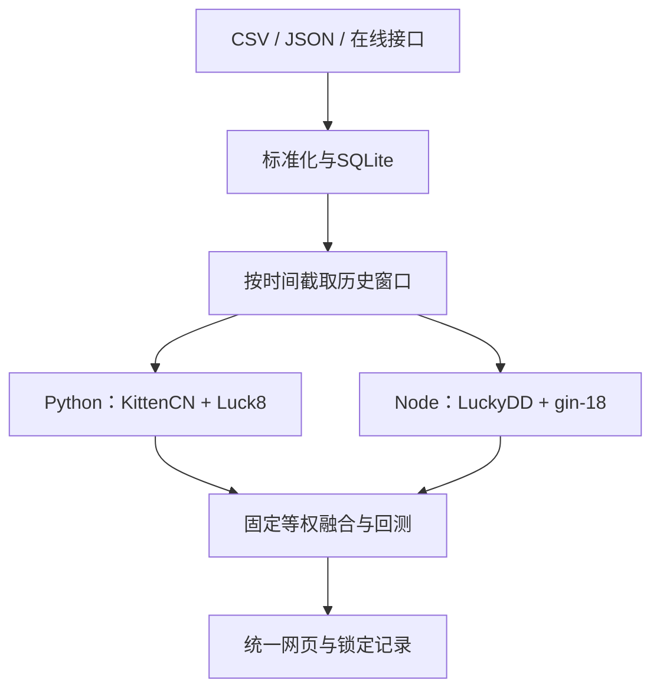

# 结构与数据流

`fusion/data.py`负责输入校验、原子导入、指纹和锁定记录查询；`engine.py`负责上游Python调用、融合和滚动回测；`bridge.mjs`负责直接调用JavaScript/TypeScript纯函数；`provider.py`负责网络采集；`server.py`提供同源HTTP API；`web/`是无构建步骤的统一前端。

## 接口

| 方法 | 路径 | 用途 |
|---|---|---|
| GET | /api/status | 数据日期、来源、近期开奖 |
| GET | /api/analysis?k=10&window=120 | 运行统一分析 |
| POST | /api/backtest | `{k,window,folds,seed}` 滚动回测 |
| POST | /api/import | `{csv}` 或 `{draws}` 原子导入 |
| POST | /api/sync | 拉取在线数据后校验导入 |
| GET | /api/export | 导出标准JSON |
| POST | /api/calculate | `{k,selected,hits}` 规则计算 |
| POST | /api/experiments | `{targetIssue,k,window,seed}` 锁定分析 |
| GET | /api/experiments | 获取锁定记录及开奖后结果 |

## 研究约定

所有预测输入严格截断于目标期之前；三个模型固定等权，不在测试集上调参。均匀随机分支与各模型使用相同选号数量。分数不是校准概率。禁止把短期回测命中数当成长期优势。

当前版本的局限：内置数据截止2026-10-17且后续需要更新、在线源可用性依赖网络、奖金表未实时核验、无公网账户体系、未接入所有上游实验算法、锁定记录只由本地数据库保存。多个分析分支共享相同历史信息，不能假定其独立，融合也不保证优于单个分支。
